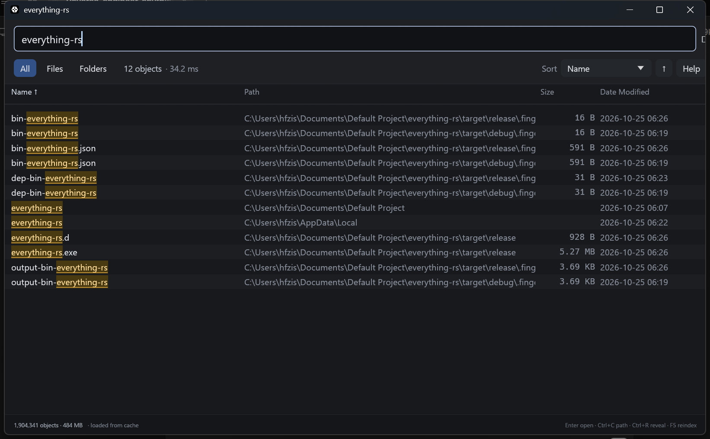

# everything-rs

A from-scratch Rust rewrite of **Everything** (voidtools, v1.4.1.1026): the
instant file search for Windows. Same idea — keep every file name resident in a
compact index and answer queries in single-digit milliseconds — rebuilt on a
modern, memory-safe core with a GPU-accelerated UI.



## Download

Prebuilt Windows x64 binaries are attached to the
[**v0.1.0 release**](https://github.com/Viper241/everything-rs/releases/latest):

| File | What it is |
| --- | --- |
| `everything-rs.exe` | the desktop app (no console window) |
| `ev.exe` | the command line front end |
| `everything-rs-0.1.0-win64.zip` | both binaries + a quick-start README |

No installer and no runtime dependencies — copy the exe anywhere and run it.
The binaries are unsigned, so SmartScreen may warn on first launch
("More info" → "Run anyway"). Or build from source in one command (below).


```
everything-rs/
├─ crates/
│  ├─ ev-core     index layout, query language, search engine, persistence
│  ├─ ev-ntfs     MFT/USN enumeration, folder walk, metadata cache
│  ├─ ev-cli      `ev` - scriptable command line front end
│  └─ ev-gui      `everything-rs` - the desktop app
└─ Cargo.toml
```

## Why a rewrite

Everything is a masterclass in Windows engineering, but it is a 32-bit C/C++
application from 2009 with a Win32 list view, an embedded HTTP/ETP/FTP server,
a kernel-adjacent service, and a database format nobody can reimplement. This
project keeps the parts that make it feel instant and rebuilds them as a
readable, testable, 64-bit Rust codebase:

| Everything 1.4.1.1026 | everything-rs |
| --- | --- |
| MFT enumeration via `FSCTL_ENUM_USN_DATA` | same ioctl, same speed class, in `ev-ntfs` |
| USN journal for live updates | same, replayed on startup from a saved index |
| Win32 ListView UI | egui/OpenGL, virtualised list, 60 fps while typing |
| 32-bit process, ~2 GB ceiling | 64-bit, one compact record per object |
| Closed database format | versioned + checksummed binary snapshot |

## How it works

### 1. Enumeration

* **NTFS volumes (fast path).** `FSCTL_ENUM_USN_DATA` streams every record of
  the master file table through one ioctl loop. The kernel returns name, FRN,
  parent FRN and attributes for ~2 million objects in about a second, with no
  per-file syscalls. Requires an elevated token (or a service), exactly like
  Everything.
* **Fallback.** Without privileges, a non-NTFS volume, or a mapped network
  share, the scanner walks directories with `FindFirstFileW`/`FindNextFileW`.
  One syscall per *directory* (not per file) returns name, attributes, size and
  all three timestamps, which are pushed straight into the metadata cache.
* **Live updates.** The USN journal is polled every 500 ms. Creates, deletes,
  renames and writes are coalesced per FRN and applied to the index in place.

### 2. Index layout

Everything's trick, reproduced:

```
Entry (32 bytes)          names arena       lowers arena       paths arena
┌──────────────────┐      ┌──────────┐      ┌──────────┐      ┌──────────────────┐
│ off    : u32     │─────▶│ "README" │      │ "readme" │      │ "C:\src\main.rs" │
│ len    : u16     │      │ "main.rs"│      │ "main.rs"│      │ "C:\src\lib.rs"  │
│ flags  : u16     │      └──────────┘      └──────────┘      └──────────────────┘
│ parent : u32     │──▶ parent directory id
│ path_off/len     │
│ frn, attrs       │
└──────────────────┘
```

* Every string is UTF-8 in a flat arena; the lowercased mirror has identical
  offsets, so case-insensitive matching never folds on the hot path.
* Full paths are materialised once during the build, so `path:` filters and
  the Path column cost nothing at query time.
* Metadata (size, times) lives in `Vec<AtomicU64>`/`Vec<AtomicI64>` slots so a
  background prefetch can fill them while searches read them lock-free.

### 3. Query language

A hand-written tokenizer → AST → predicate tree, with Everything's grammar:

```
term   := "!" term | "(" expr ")" | function | word
and    := term+            (whitespace)
or     := and ("|" and)*
```

`regex:` is backed by a small Thompson-style engine (alternation, classes,
anchors, `\b`, greedy/lazy `* + ?`, `{n,m}`, escapes) executed by a
backtracking VM with a step budget, so a pathological pattern cannot hang the
search thread. Wildcards (`*`, `?`) use an iterative glob matcher.

### 4. Search

* **Fast path.** A single plain substring term (every keystroke in practice)
  takes a dedicated branch: a linear scan over the lowercased arena using
  `memchr`'s SIMD substring search.
* **General path.** AND terms are reordered by selectivity, OR/NOT/functions
  are evaluated per entry, and cancellation is checked every 16 K entries.
* **Sorting on a worker.** Matching, sorting and dupe detection all run on a
  dedicated thread; the UI only ever borrows the index for the ~40 visible
  rows. Typing never blocks.
* **Paging.** Results can be tens of thousands of ids; the list is virtualised
  and only visible rows are formatted.

### 5. Persistence

The index is written to `%LOCALAPPDATA%\everything-rs\index.evdb`
(atomic temp-file + rename, FNV-1a checksum, offset validation on load). The
current USN position of each volume is stored with it, so on the next start the
journal is replayed from that point; if the journal was recreated or wrapped,
the app transparently falls back to a full scan. This is why a restart is
instant even though the first index of `C:` is not.

## Performance (measured on this machine, non-elevated)

| Operation | Result |
| --- | --- |
| Folder index, 10,203 objects | 84 ms |
| `C:\` full walk, 1,904,341 objects | 3.5-5 min (unprivileged, I/O bound) |
| Cold start from the 462 MB snapshot | ~2.5 s |
| All 1.9 M objects, default name view | **18.9 ms** |
| `main.rs` over 1.9 M objects (20 hits) | **35.6 ms** |
| Index memory, 1.9 M objects | 484 MB |
| Unit tests | 23 passing |

The `C:\` walk is I/O bound and anti-virus bound: it takes one directory open
per folder. Run elevated and the MFT path indexes the same volume in the
low seconds with no per-file I/O at all. That is the same trade-off Everything
makes (hence its service).

Two things make the interactive path fast even at 1.9 M objects:

* **The index is stored in name order.** Build permutes entries, parent links
  and roots by lowercased name, so the default "Name ascending" view needs no
  sort at all — the result list *is* the scan order. Sorting 1.9 M names was
  the single most expensive operation in the app: 1.9 s before, 0 after.
* **A specialised scan loop** for the common one-word query walks the packed
  lowercased arena with a precompiled `memmem::Finder`, with one bounds check
  and no dynamic dispatch per entry.

### Persistence details

The snapshot is versioned and checksummed; a corrupt or truncated file is
rejected and triggers a rescan rather than a panic. If the USN journal is
available, changes made while the app was closed are replayed on load
(creates, deletes and renames). Without journal access — the normal case for an
unelevated process — a snapshot younger than an hour is served as-is instead of
forcing a multi-minute walk, and F5 rebuilds on demand.


## Building

```
cargo build --release
target/release/everything-rs.exe          # GUI
target/release/ev.exe "*.rs dm:today"     # CLI
```

Requires Windows 10+ and Rust 1.85+ (edition 2024). No C toolchain, no
external services; the only dependencies are `eframe`/`egui`, `memchr` and
`windows-sys`.

## CLI

```
ev package.json                  # instant search
ev "ext:rs;toml size:>20kb"      # filters
ev --detail "dm:today"           # size/date columns
ev --json "ext:png"              # machine readable
ev --index                       # build and report statistics
ev --watch                       # follow the USN journal, print changes
ev --folders "D:\share" --index  # index a folder instead of a volume
```

## Search syntax

| Syntax | Meaning |
| --- | --- |
| `foo bar` | both terms (AND) |
| `foo\|bar` | either term (OR) |
| `!foo` | exclude |
| `"exact phrase"` | literal spaces |
| `(a b) \| c` | grouping |
| `*.rs`, `file?.txt` | wildcards |
| `regex:^m.*\.rs$` | regular expression |
| `case:`, `nocase:` | case sensitivity |
| `ww:`, `noww:` | whole words |
| `path:` / `nopath:` | match the full path |
| `file:` / `folder:` | restrict to files / folders |
| `startwith:`, `endwith:`, `wholefilename:` | anchored matches |
| `ext:rs;toml` | extension list |
| `size:>1mb`, `size:empty`, `size:1mb..2mb` | size, constants (`tiny`, `small`, `medium`, `large`, `huge`, `gigantic`, `unknown`) |
| `dm:today`, `dc:last7days`, `da:2024-05` | dates (also `yesterday`, `thisweek`, `lastmonth`, ISO forms) |
| `attrib:HD`, `attributes:hidden` | NTFS attribute bits |
| `len:<12` | file name length |
| `parent:C:\Windows` | direct children |
| `infolder:C:\Windows` | whole subtree |
| `depth:2`, `root:` | nesting |
| `dupe:`, `sizedupe:`, `dmdupe:`, `dcdupe:`, `dadupe:` | duplicate detection |
| `count:20` | result limit |
| `frn:1234` | file reference number |
| `audio: video: pic: doc: exe: zip:` | extension macro groups |
| `type:video` | same groups as a function |

## Parity and known gaps

Implemented: instant substring search, NTFS MFT indexing, USN live updates,
on-disk index, folder indexing, the search grammar above, sorting by
name/path/size/date/extension/type, virtualised UI, open/reveal/copy.

Deliberately not implemented (yet): the HTTP/ETP/FTP servers, the Windows
service, global hotkeys, IPC/SDK (`Everything_SetSearch` style), file lists
(`.efu` import/export), multi-file rename, content search, shell icon
extraction, and media metadata (`artist:`, `album:`). Search functions that are
recognised but unsupported produce a visible warning instead of silently
matching everything.

Deviations from Everything 1.4:

* `infolder:` matches the whole subtree (the 1.4 help text says "excluding
  subfolders" for both `parent:` and `infolder:`; the recursive behaviour is
  what users expect).
* Bracket grouping is always enabled.
* `regex:` supports the documented subset; backreferences (`\1`) are not
  implemented.
* Unicode case folding is ASCII-only (Everything's "fast ASCII comparison"
  behaviour); non-ASCII names still match exactly, and CJK text is rendered
  with the system fallback font.

## Reverse-engineering notes

The reference binary in `C:\Program Files (x86)\Everything\Everything.exe`
(1.4.1.1026, PE32 x86, SHA-256 `fb653fd8…5bbc`) was inspected statically:

* Imports confirm the architecture: `DeviceIoControl`, `CreateFileW`,
  `FindFirstFileW`, `SHGetDesktopFolder`, Winsock for the ETP/FTP/HTTP servers,
  and service-control APIs.
* The embedded help strings were extracted and used verbatim for the CLI flag
  list (`-create-usn-journal`, `-sort`, `-parentpath`, …), the search function
  table (`ext:`, `dm:`, `attribdupe:`, `childfilecount:`, …), the size and date
  constants, and the media extension groups in `ev-core/src/query.rs`.
* `Everything.ini` in the install directory shows the settings-only startup
  form (`app_data=1`, `allow_http_server=1`, …) that the config parser mirrors
  in spirit.

No disassembly was required for behaviour: the interesting contract is the
Windows search grammar and the MFT/USN interfaces, both of which are documented
and were verified against the shipped strings.

## License

MIT.
